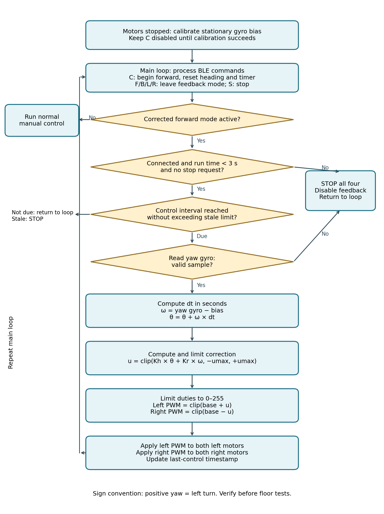

# Lab 3 — BLE Motor Control + IMU Bring-Up

<div class="lab-meta" markdown>
<div><span class="k">Date</span><span class="v">Wednesday 7 October</span></div>
<div><span class="k">Depends on</span><span class="v">Lab 2</span></div>
<div><span class="k">Milestone</span><span class="v">Working car, phone controls and IMU readings</span></div>
<div><span class="k">Next</span><span class="v">IMU straight-line controller, in <a href="../lab04-encoders-straight-line/">Lab 4</a></span></div>
</div>

## Objectives

Verify all four motors, the BLE buttons and the stop conditions, and identify
the gyro axis and units. Prepare the encoder wiring for next week.

## Equipment and starter files

ESP32 DevKit, USB cable, IMU module, four motors, four compatible PWM/DIR driver
channels (one per motor), appropriate motor supply, chassis, jumper wires, phone,
ruler or tape measure, and floor marking tape.

| File | Use |
| --- | --- |
| [`ESP32_IMU_Direct_Test.ino`](lab03/ESP32_IMU_Direct_Test.ino) | Sensor-only test |
| [`ESP32_Motors_MPU6050.ino`](lab03/ESP32_Motors_MPU6050.ino) | Starter firmware: BLE motor commands and IMU telemetry |

The starter's `M1` and `M2` names are the **left and right sides**, not
individual motors. The same commands drive all four motors through the shared
side inputs.

## Connections

| Device / signal | ESP32 connection |
| --- | --- |
| IMU VCC | 3.3 V (use a module rated for this supply) |
| IMU GND | GND |
| IMU SDA | GPIO21 |
| IMU SCL | GPIO22 |
| Front-left and rear-left driver PWM / DIR | GPIO25 / GPIO26, shared by both left channels |
| Front-right and rear-right driver PWM / DIR | GPIO27 / GPIO14, shared by both right channels |

## Task 1 — Verify the IMU

1. Connect only the IMU and upload `ESP32_IMU_Direct_Test.ino`. Select the correct ESP32 board and port; open the Serial Monitor at 115200 baud.
2. Record the I2C address and `WHO_AM_I` value. Our working module answered at `0x69` with identity `0x70`; the sketches accept `0x68` and `0x70`. Record what your module reports rather than trusting its label.
3. Keep the sensor still. Acceleration magnitude should be about 9.8 m/s² and angular velocity near zero, with some offset and noise.
4. Tilt the board and watch gravity move between the acceleration axes. Rotate the car about its vertical axis and identify which gyro axis and sign represent a **left turn**.

<div class="worksheet" data-worksheet="lab03-imu" markdown>

| Check | Observation |
| --- | --- |
| I2C address / identity | `______` |
| Acceleration while stationary | `______` |
| Yaw axis / left-turn sign | `______` |
| Gyro offset while stationary | `______` |

</div>

The combined starter uses ±2 g and ±250 °/s ranges. Over BLE it reports `AX`,
`AY`, `AZ` in m/s², `GX`, `GY`, `GZ` in rad/s, and `TEMP` in °C. Do not mix
rad/s and °/s in the controller.

## Task 2 — Upload and connect over BLE

1. Upload `ESP32_Motors_MPU6050.ino`. Its Wire and BLE headers come with the Espressif ESP32 board package; no separate IMU library is needed.
2. If the upload reports *Wrong boot mode*, hold **BOOT** when `Connecting…` appears, tap **EN**, and release BOOT when writing starts. Reset after upload if needed.
3. Open nRF Toolbox, choose **Connect to Device**, and connect to `ESP32-Motors`. Find its UART message area.
4. Send `S` first. Send `I` to enable IMU telemetry and check the readings change; send `I` again to turn it off.
5. With the wheels raised, send `1` then `F`. All four wheels must drive the car forward. Send `S`. Fix an individual reversed motor in the wiring; use the polarity constants only when a whole side is reversed.

Each movement command lasts **at most three seconds**. A speed change or
telemetry command does not restart the timer. `S` and a BLE disconnect stop the
motors.

## Task 3 — Build phone buttons

In nRF Toolbox on iOS: open **All Messages**, expand **Presets**, tap **+**, and
create a preset named *Motors*. Open its edit control, select each grid position,
choose **Text command**, enter the single character, pick a symbol, and save.
Labels and paths vary by app version; use the UART preset editor.

| Button | Sends | Action |
| --- | --- | --- |
| Forward | `F` | All four motors forward |
| Back | `B` | All four motors reverse |
| Left | `L` | Left motors reverse, right motors forward |
| Right | `R` | Left motors forward, right motors reverse |
| Stop | `S` | Stop all four motors |
| Low | `1` | PWM 90 |
| Medium | `2` | PWM 150 |
| High | `3` | PWM 230 |
| IMU | `I` | Toggle sensor messages |

**Suggested grid**

| | | |
| --- | --- | --- |
| Low `1` | Forward `F` | High `3` |
| Left `L` | Stop `S` | Right `R` |
| Medium `2` | Back `B` | IMU `I` |

1. Test every button with the wheels raised. Confirm the UART acknowledgments and the motor directions.
2. Use low speed for floor trials. Test Stop, disconnect, and the three-second timeout.
3. Put the car on a marked start line. Send `1` then `F` once, let it stop, and record forward distance and sideways displacement. Repeat three times under the same conditions.

A single tap commands motion; it is not hold-to-run. The timeout sets the run
length unless you stop sooner.

### Baseline measurement

<div class="worksheet" data-worksheet="lab03-baseline" markdown>

| Trial | Forward distance (cm) | Sideways displacement (cm) | Drift left/right |
| --- | --- | --- | --- |
| 1 | `____` | `____` | `____` |
| 2 | `____` | `____` | `____` |
| 3 | `____` | `____` | `____` |

</div>

Keep this table. Lab 4 compares the IMU-corrected run against it.

## Before Lab 4

- Wire the encoders, ready to validate next week.
- Complete the homework below. It is tested in [Lab 4](lab04-encoders-straight-line.md).

## Homework — Drive the car in a straight line

Improve the car's three-second forward run using IMU feedback. Implement the
controller in a copy of the starter sketch and compare it with the existing `F`
command. The front and rear motors on each side receive the same duty command.

### What you must implement

1. **Calibrate the yaw gyro** while the car is stationary for 2–3 s with all motors stopped. Average the samples to estimate the bias. Reject the calibration if reads fail or the car moves; keep corrected driving disabled until calibration succeeds.
2. **Add a `C` command** and phone button for corrected forward motion. Keep `F` as the baseline. On `C`, reset the relative heading to zero, set both sides forward, and start a fresh three-second timer.
3. **Update the controller locally every 10–20 ms.** Use the actual elapsed time in seconds. Keep the once-per-second BLE telemetry separate from the control loop.
4. **Use the equations below** to remove the gyro bias, integrate heading, compute a limited correction and adjust both sides. Verify the yaw axis and sign before enabling correction.
5. **Apply feedback only during `C` motion.** `S`, a disconnect, the three-second timeout, a failed sensor read or a stale controller must stop all four motors and disable feedback. Choose and document a stale limit, for example 100 ms. `F`/`B`/`L`/`R` must exit feedback mode.
6. **Keep front-left and rear-left duties equal**, and front-right and rear-right equal. Once directions are set, update the PWM directly; do not call `applyMotion()` every cycle, because it adds a 20 ms off interval.

### Test before driving

Raise the wheels and gently turn the chassis left during corrected motion. The
duty change must **oppose** the measured turn; if it reinforces it, reverse the
correction sign. Start floor tests at low speed with a limited correction, for
example ±30 PWM counts. Tune the gains experimentally; they are not universal
values.

### Control equations

Use radians, rad/s and seconds throughout. clip(x, a, b) = min(max(x, a), b).
Subscript *k* is the current sample, *k*−1 the previous one.

**1. Stationary gyro bias**

$$ b = \frac{1}{N} \sum_{i=1}^{N} g_i $$

**2. Bias-corrected angular velocity**

$$ \omega_k = g_k - b $$

**3. Elapsed time and relative heading**

$$ \Delta t_k = \frac{t_k - t_{k-1}}{10^6} \qquad \theta_k = \theta_{k-1} + \omega_k \Delta t_k, \quad \theta_0 = 0 $$

Timestamps from `micros()`; for `millis()` divide by 1000 instead. Reset θ and
the previous-control timestamp at the start of each `C` run.

**4. Heading and yaw-rate correction**

$$ u_k = \operatorname{clip}(K_h \theta_k + K_r \omega_k,\ -u_{max},\ +u_{max}) $$

**5. Left and right duties**

$$ P^L_k = \operatorname{clip}(P_0 + u_k, 0, 255) \qquad P^R_k = \operatorname{clip}(P_0 - u_k, 0, 255) $$

These signs assume positive yaw is a left turn: more left duty and less right
duty gives a right-turn correction.

**6. Apply to all four motors**

$$ P_{FL} = P_{RL} = P^L_k \qquad P_{FR} = P_{RR} = P^R_k $$

This controller tries to hold the starting heading. A gyro has bias and drift
and does not measure sideways position, and zero yaw rate alone cannot restore a
heading that has already changed.

### Algorithm

Stop checks must stay responsive between controller updates; return to the main
loop immediately when an update is not yet due.



## Starter code

??? example "ESP32_IMU_Direct_Test.ino"
    ```cpp
    --8<-- "docs/labs/lab03/ESP32_IMU_Direct_Test.ino"
    ```

??? example "ESP32_Motors_MPU6050.ino"
    ```cpp
    --8<-- "docs/labs/lab03/ESP32_Motors_MPU6050.ino"
    ```
