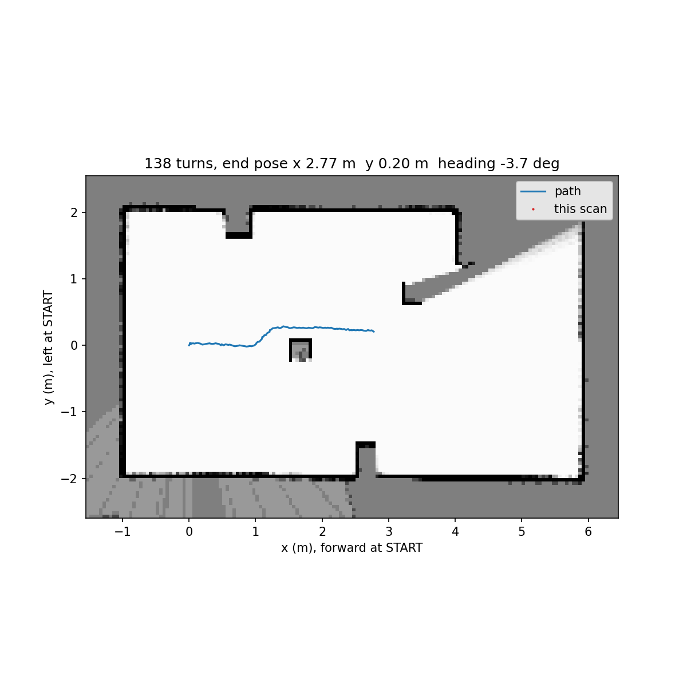

# Lab 7 — Driving with the LiDAR

<div class="lab-meta" markdown>
<div><span class="k">Date</span><span class="v">Wednesday 11 November</span></div>
<div><span class="k">Depends on</span><span class="v">Labs 3 to 6</span></div>
<div><span class="k">Milestone</span><span class="v">Car drives past an obstacle using the lidar, started from ThingsBoard</span></div>
</div>

**Goal:** mount the RPLiDAR on your car, check what it sees, then let the car
drive by itself and steer around obstacles. Then start and stop it from
the ThingsBoard dashboard on your laptop. If you have time, build a map of
the room on your laptop as the car drives (Step 6).

The lidar spins and measures distance all around the car, about 6 times a
second. In Lab 5 the car had to stop and turn to look left and right. Now it
sees both sides at once.

**You do not write the code from scratch.** You get three sketches. You set
your car's values, test, and tune.

| Step | Sketch | What it does |
| --- | --- | --- |
| 2–3 | [`ME222_Lab7_1_LidarTest.ino`](lab07/ME222_Lab7_1_LidarTest.ino) | Shows what the lidar sees. The car does not move. |
| 4 | [`ME222_Lab7_2_Drive.ino`](lab07/ME222_Lab7_2_Drive.ino) | The car drives and avoids obstacles. |
| 5 | [`ME222_Lab7_3_Drive_ThingsBoard.ino`](lab07/ME222_Lab7_3_Drive_ThingsBoard.ino) | Same, started and watched from ThingsBoard. |
| 6 (extra) | [`lab7_slam.py`](lab07/lab7_slam.py) + the SLAM add-on | Live map of the room on your laptop. |

**Bring:** the car with a charged battery, USB cable, a tape measure, and a
matte, light-coloured box at least 20 cm wide.

## Step 1 · Wire the lidar

Battery **off** while you wire. Your car keeps its one ESP32 and its Lab 6
wiring.

1. **Take out the TF-Luna.** Unplug it and put it aside. The lidar replaces it.
   Leave the motors and IMU as they are.
2. **Mount the lidar** on top of the car, in the middle, with nothing taller
   than its head around it.
3. **Wire it** to the ESP32:

| Lidar wire | Connect to |
| --- | --- |
| TX | ESP32 **GPIO 16** |
| RX | ESP32 **GPIO 17** |
| MOTOCTL | ESP32 **GPIO 4** |
| VCC_5 | ESP32 **5V** pin |
| 5V_MOTO | ESP32 **5V** pin |
| GND | ESP32 GND |
| GND_MOTO | ESP32 GND |

All the sketches already use these pins. If GPIO 4, 16 or 17 is already
used on your car, tell a TA before you rewire.

!!! warning "Handling"
    Do not hold or stop the spinning head, and keep wires clear of it.

## Step 2 · Check the lidar

1. Upload `ME222_Lab7_1_LidarTest.ino`.
2. Switch the battery on. The lidar head should start spinning.
3. Open the Serial Monitor at **115200** baud. About once a second you see:

```text title="Serial Monitor"
6.3 turns/s 318 pts | nearest   412 mm at  87 | ahead  clear | left  clear | right  clear | CLEAR | sync errors 0
```

It is working if *turns/s* is between 5 and 10 and *sync errors* stays at 0.
Move your hand around the lidar at 30 cm: the *nearest* bearing follows your
hand.

<div class="worksheet" data-worksheet="lab07-bringup" markdown>

| Turns per second | Points per turn | Sync errors |
| --- | --- | --- |
| `______` | `______` | `______` |

</div>

## Step 3 · Point it forward and check the lanes

**Goal:** tell the sketch where the front of your car is, then check that it
sees a box in the right place. You need these values for driving in Step 4.

The sketch gives every direction around the car as a **bearing**: degrees,
clockwise from the front.

{{ svg assets/lab07-bearings.svg }}

### Point it forward

The lidar's own 0° is wherever its head happened to point when you mounted
it. These four values tell the sketch how it sits on your car.

1. Hold your hand 30 cm in front of the car's nose. Read the *nearest*
   bearing. Put that number in `ANGLE_OFFSET_DEG` and upload again. Your hand
   in front should now read close to 0 (357 to 3 is fine).
2. Hold your hand at the car's **right** side. It should read near 90. If it
   reads near 270, set `ANGLE_REVERSED = true` and upload.
3. Take your hand away. If *nearest* still shows a short distance that never
   changes, the lidar is seeing part of your car. Raise `D_MIN_MM` until it
   goes away.
4. Measure your car's width and put it in `CAR_WIDTH_MM`.

Write down your four values. You copy them into the drive sketch in Step 4.

<div class="worksheet" data-worksheet="lab07-values" markdown>

| `ANGLE_OFFSET_DEG` | `ANGLE_REVERSED` | `D_MIN_MM` | `CAR_WIDTH_MM` |
| --- | --- | --- | --- |
| `______` | `______` | `______` | `______` |

</div>

### Check the lanes

Put the box in each position below. Each Serial line ends with what the car
would do: **CLEAR**, **AVOID LEFT**, **AVOID RIGHT** or **BLOCKED**. Write
that word in the table. If it does not match *Expected*, check your four
values again.

<div class="worksheet" data-worksheet="lab07-lanes" markdown>

| Box | The sketch says | Expected |
| --- | --- | --- |
| No box | | CLEAR |
| 40 cm in front, sticking out to the car's right | | AVOID LEFT |
| 40 cm in front, sticking out to the car's left | | AVOID RIGHT |
| 40 cm in front, plus a box 40 cm ahead-left and one 40 cm ahead-right | | BLOCKED |

</div>

## Step 4 · Drive

### What the car does

1. You press **START**. The car stays still for 1 second while it calibrates
   the gyro.
2. It drives forward and holds its heading with the gyro, as in Lab 4.
3. When something is in the *ahead* lane closer than `D_AVOID_MM` for two
   lidar turns in a row, it turns 45° away from it and keeps driving.
4. When the lidar shows that the original direction is clear again, it turns
   back and carries on. It ends up parallel to where it started, a little to
   one side.
5. If there is no way through, it stops and waits (**BLOCKED**). It drives on
   by itself when the path clears.
6. It stops by itself after 20 seconds.

**START and STOP:** press the **BOOT** button on the ESP32, or send `g` (go)
and `s` (stop) in the Serial Monitor.

### Set up

1. Open `ME222_Lab7_2_Drive.ino`.
2. **Section 1:** copy in your four values from Step 3.
3. **Section 6:** fill in your motor pins (your Lab 1 table), the `pinMode`
   lines, and one `motor(...)` line per motor.
4. Upload. Wheels off the table, send `t` in the Serial Monitor: the left
   wheels turn, then the right wheels, then the car turns on the spot. A wheel
   turns the wrong way? Swap its IN1 and IN2 in section 6.

### Test with the wheels raised

Put the car on a stand so the wheels are off the table.

1. Press **BOOT**. After 1 second, all four wheels turn **forward**.
2. Turn the car gently to the left by hand. The left wheels should speed up
   and the right wheels slow down. If it is the other way round, set
   `YAW_SIGN = -1.0f`.
3. Hold the box 40 cm in front of the lidar. The wheels should switch to
   turning on the spot. On the stand the car cannot actually turn, so after
   4 seconds it stops with *turn took too long*. That is expected.
4. Press **BOOT** to stop, or to start again.

### Test on the floor

Unplug the USB cable. The car runs from its battery.

1. **No obstacle.** Press BOOT and let the car drive. It should go straight.
2. **One box** about 1.5 m ahead. Run it three times with the box in
   different places, and record the results.

<div class="worksheet" data-worksheet="lab07-runs" markdown>

| Run | Box position | Side the car chose | Touched the box? | Back to straight? |
| --- | --- | --- | --- | --- |
| 1 | Centre | | | |
| 2 | Mostly right | | | |
| 3 | Mostly left | | | |

</div>

### Tune

Change one value at a time in **section 2**, then upload again.

| If the car… | Change |
| --- | --- |
| Turns too late or brushes the box | Raise `D_AVOID_MM` |
| Clips the box while passing it | Raise `SIDE_MARGIN_MM` |
| Turns back toward the box too early | Raise `SIDE_MARGIN_MM` |
| Swings left and right while driving straight | Lower `KH` |
| Does not turn on the spot, or turns slowly | Raise `P_TURN` |
| Is hard to follow | Lower `P_DRIVE` |

<div class="worksheet" data-worksheet="lab07-tuning" markdown>

| `P_DRIVE` | `P_TURN` | `D_AVOID_MM` | `D_STOP_MM` | `SIDE_MARGIN_MM` | `KH` |
| --- | --- | --- | --- | --- | --- |
| `______` | `______` | `______` | `______` | `______` | `______` |

</div>

## Step 5 · Start it from ThingsBoard

The same program, now connected to the ThingsBoard server on the Raspberry Pi,
as in Lab 6.

1. In the Library Manager, install **PubSubClient** by Nick O'Leary. Open
   `ME222_Lab7_3_Drive_ThingsBoard.ino`. Copy in **sections 1, 2 and 6**
   from your drive sketch.
2. Fill in the Wi-Fi password, the Raspberry Pi IP (both given in the lab) and
   your Lab 6 device token.
3. Upload. The Serial Monitor should show `ThingsBoard connected`.
4. On your laptop, open your Lab 6 dashboard. Add cards for these keys:

| Key | Shows | Unit |
| --- | --- | --- |
| `state` | READY, CALIBRATING, DRIVING, TURNING, BLOCKED, FINISHED, STOPPED | — |
| `reason` | Why the state last changed | — |
| `ahead`, `left`, `right` | Distance in each lane (300 = nothing seen) | cm |
| `heading` | Heading since START | ° |

5. Your Lab 6 **START MISSION** and **STOP** buttons work unchanged: they set
   `command` to `START` or `STOP`.
6. Press **START** on the laptop. The car calibrates for 1 second, then
   drives. Press **STOP** to stop it. The BOOT button still works too.

!!! warning "No link, no driving"
    If the car loses Wi-Fi or ThingsBoard during a run, it stops, because
    STOP could no longer reach it. It cannot start without the link either.

## Step 6 (extra) · See the lidar make a map

Nothing to hand in. Your laptop draws a map of the room and the car's path
while the car drives (**SLAM**). It needs Python on the laptop; if you do not
have it, watch the TA's demo.

1. In your Step 5 sketch, paste the **SLAM add-on** (in *Code* below) above
   section 9, and add `slamSend();` after `processScan();` in `loop()`.
2. Put your laptop's IP in `LAPTOP_IP` (Windows: `ipconfig`). Upload.
3. Run `pip install numpy matplotlib`, download
   [`lab7_slam.py`](lab07/lab7_slam.py) and run `python lab7_slam.py`. Allow it through the Windows firewall if asked.
4. Press START and watch the map build.

{ width="560" }

## Deliverable

**Deliverable:** the completed tables and a run started from the ThingsBoard
dashboard.

## Troubleshooting

??? failure "The motor test turns the wrong wheels, or nothing turns"
    The pins in section 6 do not match your wiring. With an L298N, check that
    its GND is connected to the ESP32 GND and that the ENA/ENB jumpers are
    removed so the ESP32 controls the speed.

??? failure "The SLAM window says *waiting for the car*"
    Check `LAPTOP_IP`, that the laptop is on the same Wi-Fi as the car, and
    that the Windows firewall allows Python. The port must be 5005 in both.

??? failure "`NO ANSWER from the lidar`"
    Head not spinning: check the two 5 V wires and the MOTOCTL wire on GPIO 4.
    Head spinning: the TX and RX wires are probably swapped. Lidar TX goes to
    GPIO 16, lidar RX to GPIO 17.

??? failure "`NO IMU`, or the car will not start"
    The IMU is not answering on SDA 21 / SCL 22. Check its wires. The drive
    sketches will not start without it.

??? failure "The car keeps saying *car moved: calibrating again*"
    Keep the car completely still for the first second after START.

??? failure "The car stops with *no lidar data*"
    The lidar stopped sending. Check its wiring and that the battery is on.

??? failure "The nearest point never moves and is very close"
    The lidar sees part of the car. Raise `D_MIN_MM`, or move the wire or part.

??? failure "The car does not see the box"
    Black, shiny or see-through objects return little light. Anything lower
    than the lidar head is not seen at all. Use a matte, light box that is
    taller than the lidar.

??? failure "`ThingsBoard connect failed`"
    `rc=5` means a wrong token. `rc=-2` means the ESP32 cannot reach the Pi:
    check the Wi-Fi password and the Pi IP.

## Code

??? example "ME222_Lab7_1_LidarTest.ino"
    ```cpp
    --8<-- "docs/labs/lab07/ME222_Lab7_1_LidarTest.ino"
    ```

??? example "ME222_Lab7_2_Drive.ino"
    ```cpp
    --8<-- "docs/labs/lab07/ME222_Lab7_2_Drive.ino"
    ```

??? example "ME222_Lab7_3_Drive_ThingsBoard.ino"
    ```cpp
    --8<-- "docs/labs/lab07/ME222_Lab7_3_Drive_ThingsBoard.ino"
    ```

??? example "SLAM add-on (paste into the Step 5 sketch)"
    ```cpp
    --8<-- "docs/labs/lab07/slam_addon.txt"
    ```

??? example "lab7_slam.py (runs on the laptop)"
    ```python
    --8<-- "docs/labs/lab07/lab7_slam.py"
    ```
