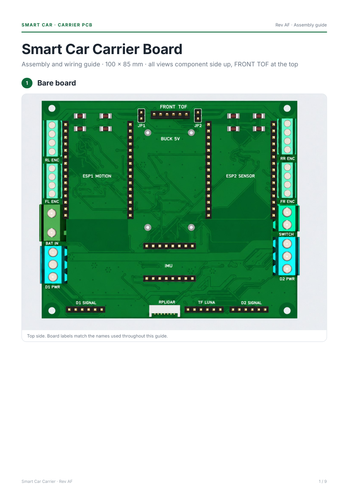
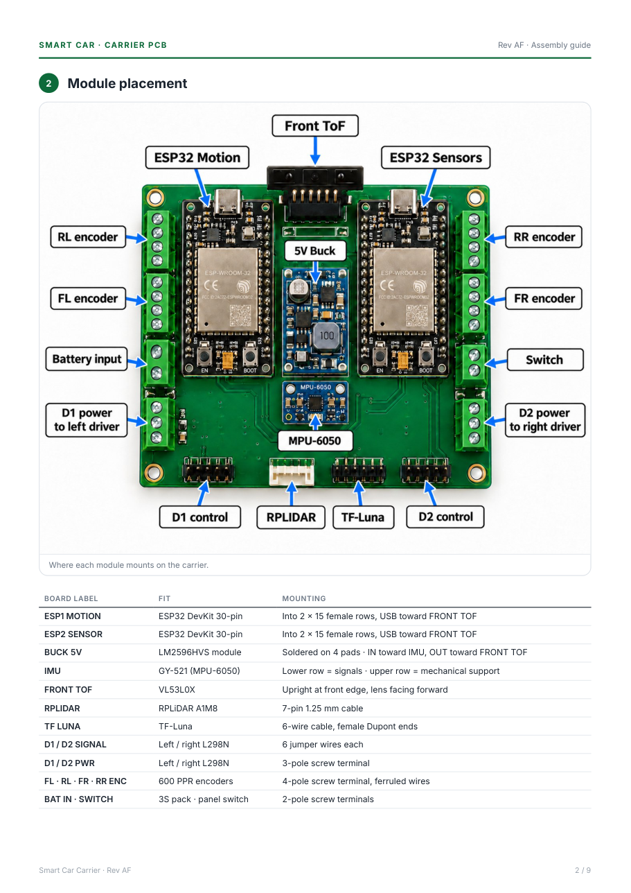
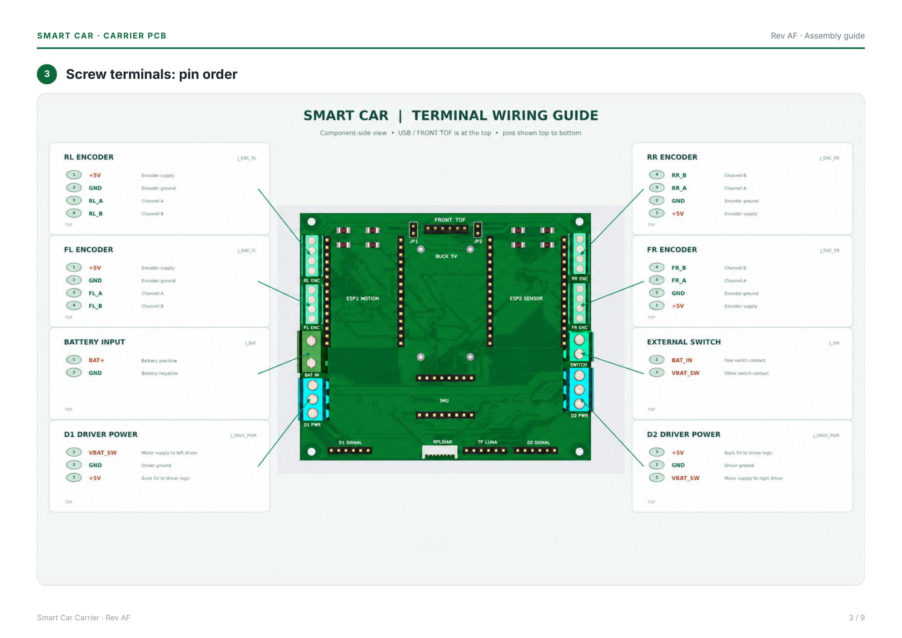
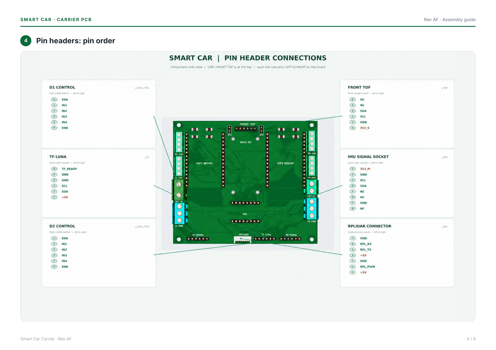
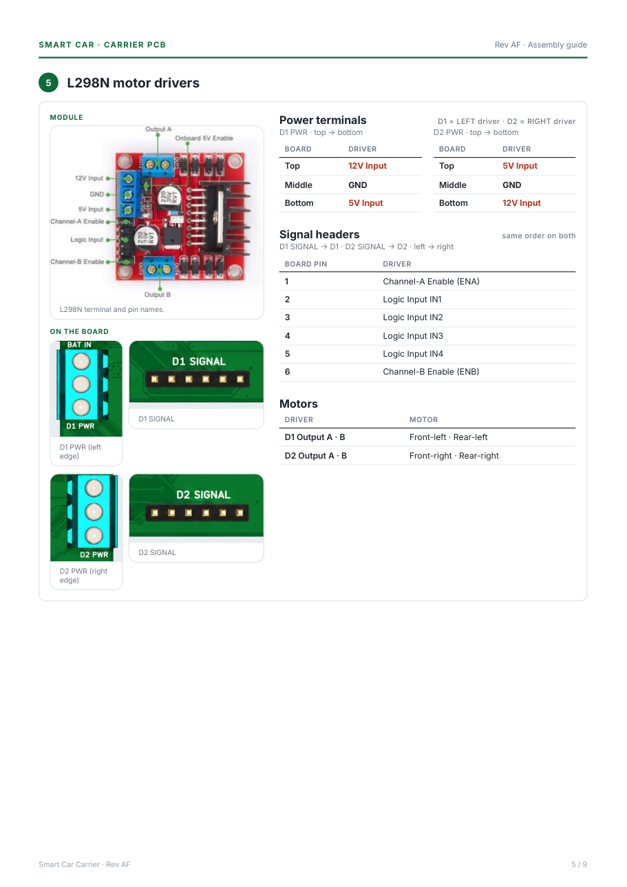
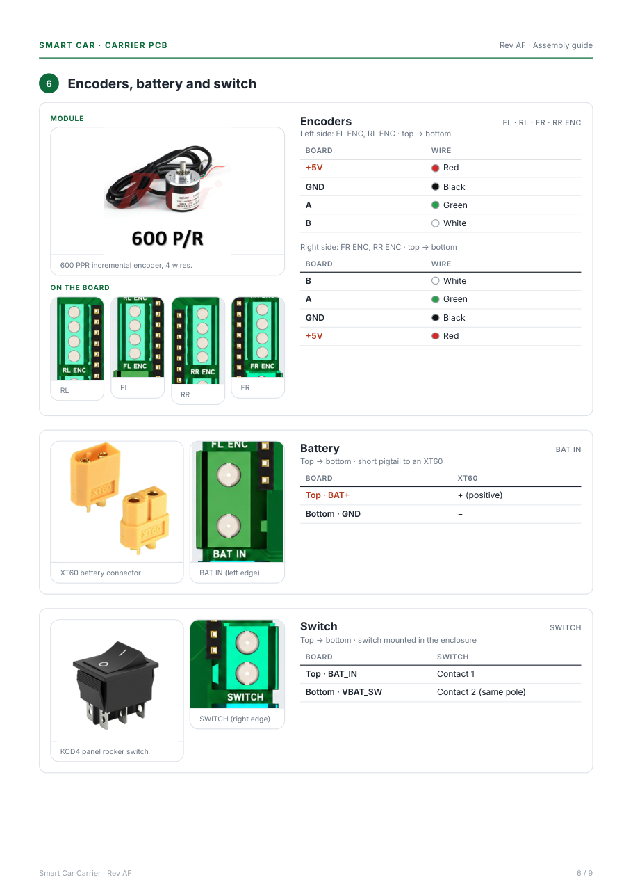
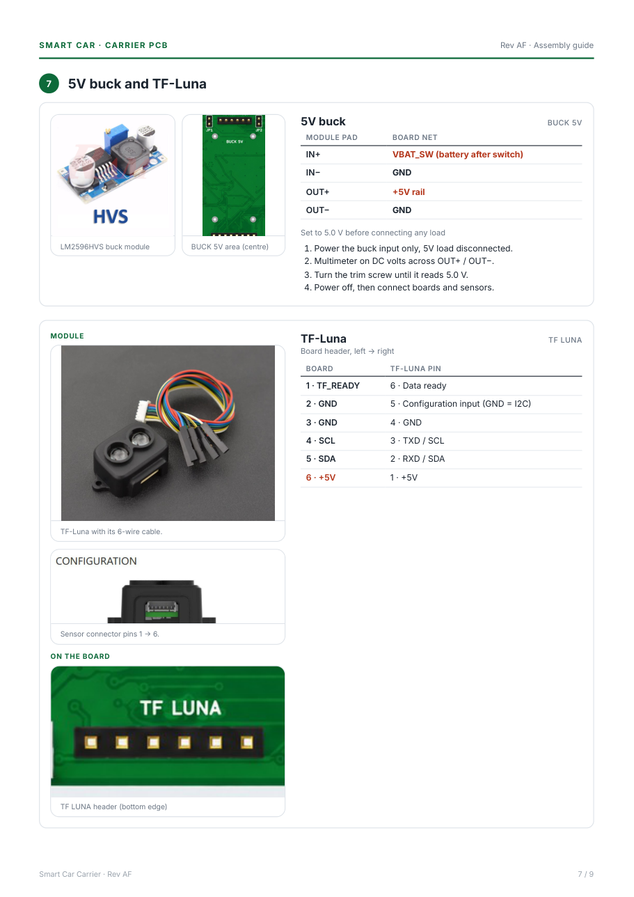
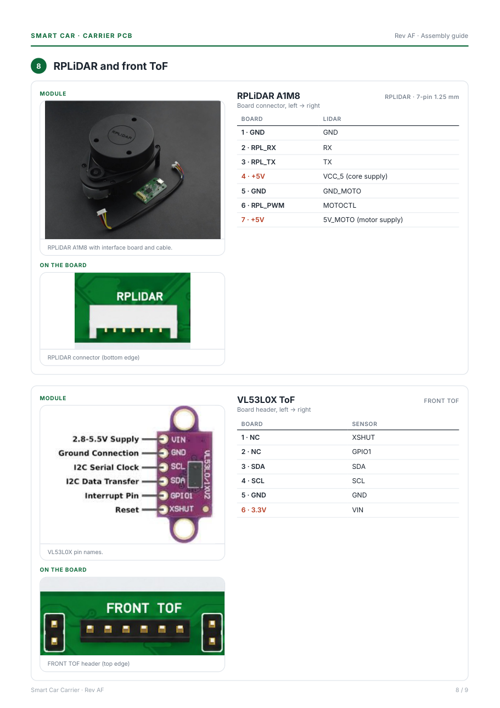
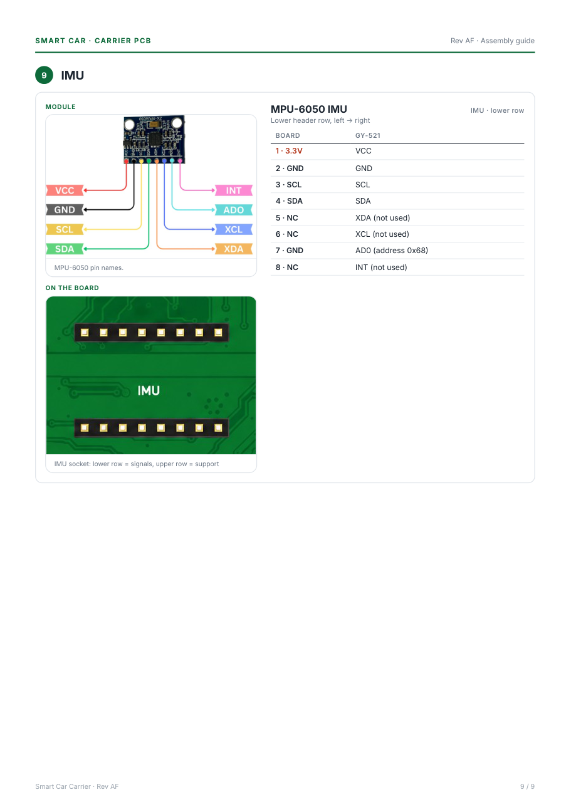

# Smart Car Carrier Board

Assembly and wiring guide for the carrier PCB, Rev AF. 100 × 85 mm. All views
are component side up, with FRONT TOF at the top.

[:material-file-pdf-box: Download the guide (PDF)](pcb/Smart_Car_Board_Guide.pdf){ .md-button }

Click any page to zoom.

